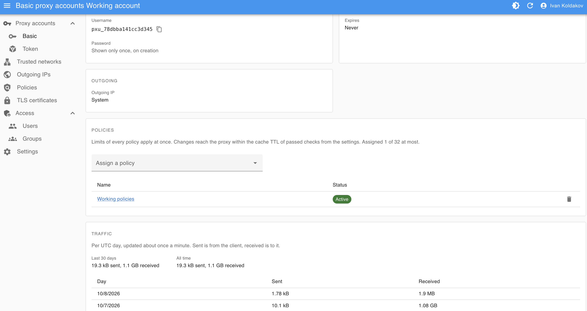
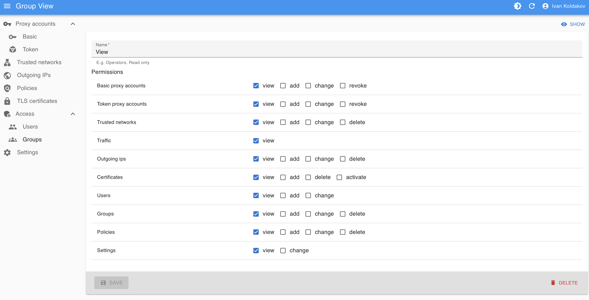

Admin UI users are managed under Access. A superuser may do everything, the first one comes from
`createsuperuser`, see [Management commands](/0.1.0/reference/management-commands/#createsuperuser). Other users get
permissions per section and action, e.g. view, add and change trusted networks, revoke basic accounts or activate
certificates, through groups and on their own: a user has the permissions of all their groups plus their own.
Traffic is a permission of its own, so a user can see accounts and networks without their traffic.

| An account: outgoing IP, policies, daily traffic                 | A read-only group: permissions per section and action                |
| ---------------------------------------------------------------- | -------------------------------------------------------------------- |
|  |  |

## Groups

Groups, e.g. Operators or Read only, are named sets of permissions. A change to a group applies to all its users.

## Rules

- A user gives only what they have: permissions, and groups whose permissions they all have. Taking away is
  always allowed. Only superusers make superusers or change them.
- Nobody deactivates themselves or takes their own superuser status away.
- An inactive user can't log in. A change of permissions or activity applies to the user's next request, the
  admin UI shows it within a minute or at the first refused action.

The admin UI hides what the user may not do: sections, buttons, the outgoing pool without access to outgoing IPs.

## Profile and passwords

- Everyone changes their own name, surname and password under Profile in the user menu, no permission needed.
  The email is the login: only a user with `users.change` changes it.
- A forgotten password is set anew with Set password on the user's page. It needs `users.change` and all the
  user's permissions, since the password gives them: the button shows only then. Only superusers set superusers'
  passwords. Without access to the admin UI, use
  [`changepassword`](/0.1.0/reference/management-commands/#changepassword).
- A new password, set any of these ways, logs the user out everywhere at their next request, as deactivation does.
  The admin UI says only that the session has expired, not why. Changing one's own password under Profile keeps
  the current session.
