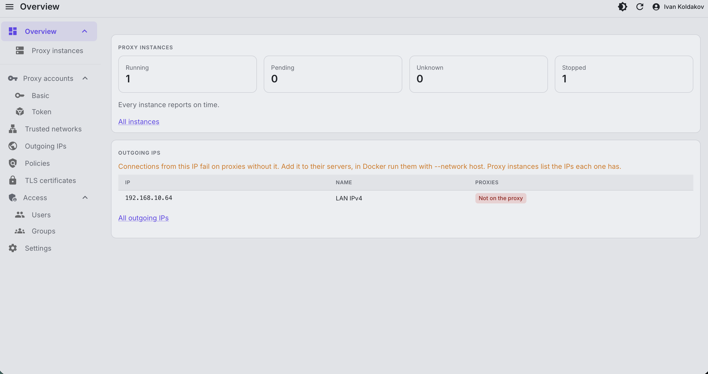
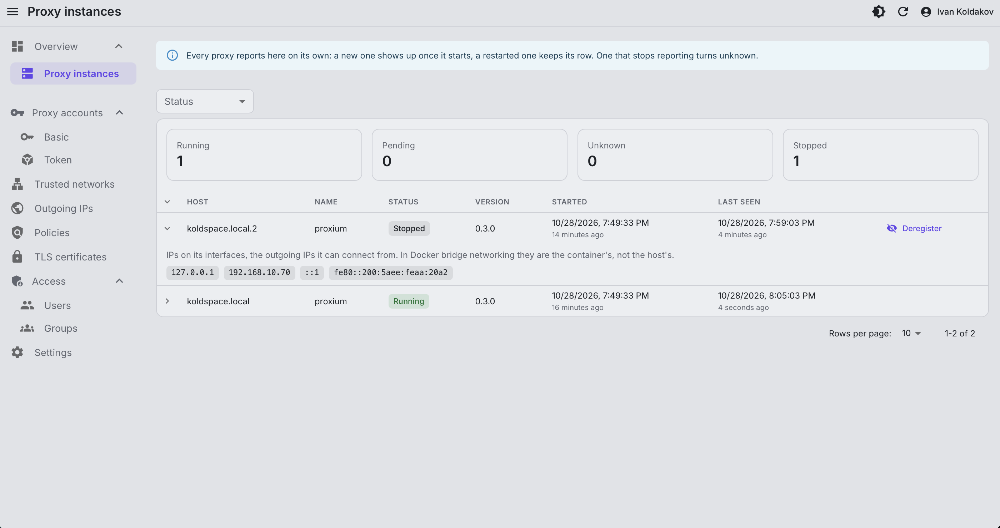

The Overview, the start page of the admin UI, counts proxies by status and lists the unknown ones. Its All instances
link, or the menu under Overview, opens the Proxy instances page with every proxy. Both refresh every few seconds.
Each proxy reports itself to the database every `PROXY_HEARTBEAT_INTERVAL` seconds, nothing to set up:

- Running: serving clients.
- Pending: starting, not serving yet.
- Unknown: missed three reports in a row, e.g. crashed, hung or cut off from the database. Worth a look.
- Stopped: shut down gracefully.

| The Overview: proxies at a glance, outgoing IPs they lack | Proxy instances: status, version, IPs of each           |
| --------------------------------------------------------- | ------------------------------------------------------- |
|                  |  |

A proxy is told apart by its machine and host name: a restart, a restart without downtime included, keeps its row.
In Docker the host name is the container's, so a recreated container is a new instance, and the old one turns
stopped. Two proxies on one machine with one host name, e.g. containers with `--network host`, share a row.

A row on the Proxy instances page opens the IPs of the proxy's interfaces, the
[outgoing IPs](/proxy/outgoing-ips/#ips-a-proxy-doesnt-have) it can connect from.

Deregister on the Proxy instances page takes a stopped or unknown instance off it, e.g. a removed server. If its
proxy reports again, it's back. It needs `proxy_instances.deregister`, seeing instances `proxy_instances.view`.
